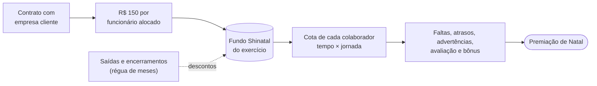
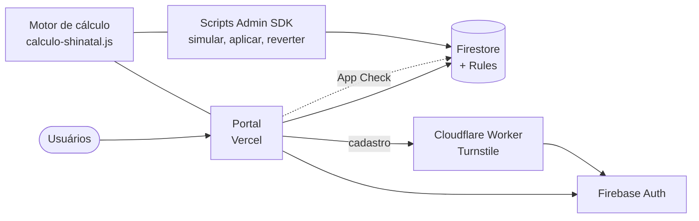

<div align="center">


### O programa de premiação de fim de ano da Shine Rio

Portal onde cada colaborador acompanha o Fundo Shinatal e a própria cota, e onde a gestão registra contratos, faltas, advertências e avaliações com regras auditáveis.

[](https://shinatal.shinerio.com)


[Produção](https://shinatal.shinerio.com) · [Arquitetura](docs/ARQUITETURA.md) · [Regras de cálculo](docs/regras/Regras_de_Calculo_Shinatal.pdf) · [Setup](docs/guias/SETUP.md) · [Documentação](docs/README.md)

<br/>


</div>

---

## Sumário

- [Visão geral](#visão-geral)
- [Funcionalidades](#funcionalidades)
- [Arquitetura em 1 minuto](#arquitetura-em-1-minuto)
- [Stack](#stack)
- [Começando](#começando)
- [Scripts](#scripts)
- [Qualidade](#qualidade)
- [Papéis de usuário](#papéis-de-usuário)
- [Segurança](#segurança)
- [Autor](#autor)
- [Documentação](#documentação)

---

## Visão geral

Todo contrato que a Shine Rio fecha com uma empresa cliente alimenta o **Fundo Shinatal**: cada funcionário alocado vale R$ 150,00 por ano (R$ 12,50 por mês). No fim do exercício, o fundo é dividido entre os colaboradores elegíveis, de forma proporcional ao tempo e à jornada de cada um, com redutores e bônus previstos no [Regulamento Interno](docs/regras/Regulamento_Interno_Shinatal.pdf).



Todo valor é **recalculado a partir das datas**. Nada em reais fica gravado por contrato, então a tela, o banco e os relatórios mostram sempre o mesmo número.

## Funcionalidades

<table>
<tr>
<td width="50%" valign="top">

**👤 Para o colaborador**

- Painel com o Fundo Shinatal do ano e a cota estimada
- Simulador do impacto de faltas, atrasos e advertências
- Perfil com histórico e download dos próprios dados (LGPD)
- Avaliação de desempenho: avaliador fixo + colega escolhido, com resposta ao Presidente
- Regulamento sempre à mão

</td>
<td width="50%" valign="top">

**🗂️ Para a gestão**

- Contratos empresariais com CNPJ validado na Receita
- Entradas, saídas e pausas por funcionário, com a régua de meses v2
- Visão global por semestre, igual à planilha de controle
- Lançamento de faltas, atrasos, advertências e avaliações
- Fila de aprovação do Presidente e histórico auditável

</td>
</tr>
</table>

## Arquitetura em 1 minuto

Sem servidor próprio: o navegador fala direto com o Firebase, protegido por regras de segurança, App Check e um Worker da Cloudflare no cadastro. Todos os números saem de um único motor de cálculo puro, compartilhado pelas telas, pelos scripts e pelos testes.



A arquitetura completa, com o modelo de dados, os fluxos, a segurança e as decisões técnicas, está em **[docs/ARQUITETURA.md](docs/ARQUITETURA.md)**.

## Stack

| Camada | Tecnologia |
|---|---|
| Página inicial | React 18, TypeScript, Vite, framer-motion |
| Portal | HTML, Tailwind CSS, módulos ES (sem framework) |
| Autenticação e dados | Firebase Authentication e Cloud Firestore (plano Spark) |
| Proteção | Firestore Security Rules, App Check (reCAPTCHA Enterprise), Cloudflare Turnstile, CSP estrita |
| Hospedagem | Vercel (deploy a cada push na `main`) |
| Testes | `node:test`, emuladores do Firebase, axe-core, Lighthouse |

## Começando

**Pré-requisitos:** Node.js 20.11 ou superior (o `test:calculo` usa `--disable-warning`) e um projeto Firebase configurado ([guia de setup](docs/guias/SETUP.md) e [requisitos](docs/guias/REQUIREMENTS.md)).

```bash
npm ci              # instala as dependências e compila o Tailwind
npm run dev         # servidor de desenvolvimento com recarga automática
npm run build       # gera dist/ exatamente como vai para produção
npm run preview     # serve o dist/ localmente
```

A configuração real do Firebase fica em `firebase-config.local.json`, fora do Git, e é embutida no build por `npm run config:firebase`.

## Scripts

| Comando | O que faz |
|---|---|
| `npm run build` | Cabeçalho e rodapé, Tailwind, checagem de tipos e build do Vite |
| `npm run test:calculo` | Testes do motor de cálculo e da planilha de controle |
| `npm run layout` | Aplica `scripts/partials/` (cabeçalho e rodapé) em todas as páginas |
| `npm run build:css` | Compila `frontend/css/tailwind.css` |
| `npm run icones` | Regera a fonte de ícones; rode ao usar um ícone novo |
| `npm run optimize:images` | Gera as versões WebP responsivas das fotos |
| `npm run optimize:video` | Gera os vídeos do topo |
| `npm run config:firebase` | Embute a configuração do Firebase em `firebase-init.js` |

**Manutenção de dados** (em `backend/scripts`, com a conta de serviço local): `recalcular-regra-v2.mjs` e `importar-planilha-controle.mjs`, sempre no ciclo `--simular`, `--aplicar` e, se preciso, `--reverter`. Veja a [seção 8 da arquitetura](docs/ARQUITETURA.md#8-manutenção-de-dados).

## Qualidade

| Área | Como é garantida |
|---|---|
| Cálculo | 79 testes: régua de meses, contratos, fundo, migração e cada linha da planilha de controle |
| Segurança | Testes das regras do Firestore no emulador e auditorias em [docs/seguranca/](docs/seguranca/) |
| Acessibilidade | WCAG 2.2 AA, ABNT NBR 17225 e eMAG; axe-core sem violações e Lighthouse 100 ([detalhes](docs/qualidade/ACESSIBILIDADE.md)) |
| Responsividade | Testada de 320 a 1920 px, sem rolagem horizontal |
| Desempenho | Fontes locais, ícones sob medida, JavaScript dividido, vídeo adiado e assets com cache de 1 ano |

Antes de publicar, rode a auditoria completa (usa os emuladores e nunca toca produção):

```bash
cd backend/tests/a11y && npm install && npm test
```

## Papéis de usuário

| Papel | Acesso |
|---|---|
| **Presidente** | Acesso total. Único que grava contratos e avaliações direto e aprova as solicitações dos demais gestores. Não participa da divisão do fundo. |
| **Admin** | Gestão completa; contratos e avaliações passam pela aprovação do Presidente. |
| **DP** | Lança falta, atraso, advertência e avaliação (a avaliação vai para aprovação). |
| **RH** | Ativa e encerra contrato e lança avaliação (ambos vão para aprovação). |
| **Colaborador** | Vê o próprio perfil, a cota estimada, o fundo, os contratos e o simulador. |

## Segurança

Nenhuma credencial, senha ou dado pessoal real fica no repositório. Leia a **[política de segurança](SECURITY.md)** antes de contribuir: ela lista o que nunca versionar e como reportar uma vulnerabilidade.

## Autor

<table>
<tr>
<td align="center" width="160">
<a href="https://github.com/Provadelli"></a><br/>
<b>Pedro Provadelli</b><br/>
<sub><a href="https://github.com/Provadelli">@Provadelli</a></sub>
</td>
<td>

**Concepção, arquitetura e desenvolvimento.**

Responsável pelo desenho do sistema, pelo motor de cálculo do Fundo Shinatal, pelas regras de segurança do Firestore, pela página inicial e pelo portal. Créditos completos em [AUTHORS.md](AUTHORS.md).

</td>
</tr>
</table>

## Documentação

| Documento | Conteúdo |
|---|---|
| [docs/README.md](docs/README.md) | Índice de toda a documentação |
| [docs/ARQUITETURA.md](docs/ARQUITETURA.md) | Arquitetura com diagramas |
| [docs/guias/SETUP.md](docs/guias/SETUP.md) | Configuração do Firebase, Turnstile, App Check e publicação |
| [docs/regras/](docs/regras/) | Regulamento interno e regras de cálculo |
| [docs/conformidade/LGPD.md](docs/conformidade/LGPD.md) | Tratamento de dados pessoais |
| [SECURITY.md](SECURITY.md) | Política de segurança |

---

<div align="center">
<sub>Concebido, arquitetado e desenvolvido por <a href="https://github.com/Provadelli">Pedro Provadelli</a></sub><br/>
<sub>© 2026 Shine Rio Group · Software de uso interno · Feito com cuidado no Rio de Janeiro</sub>
</div>
