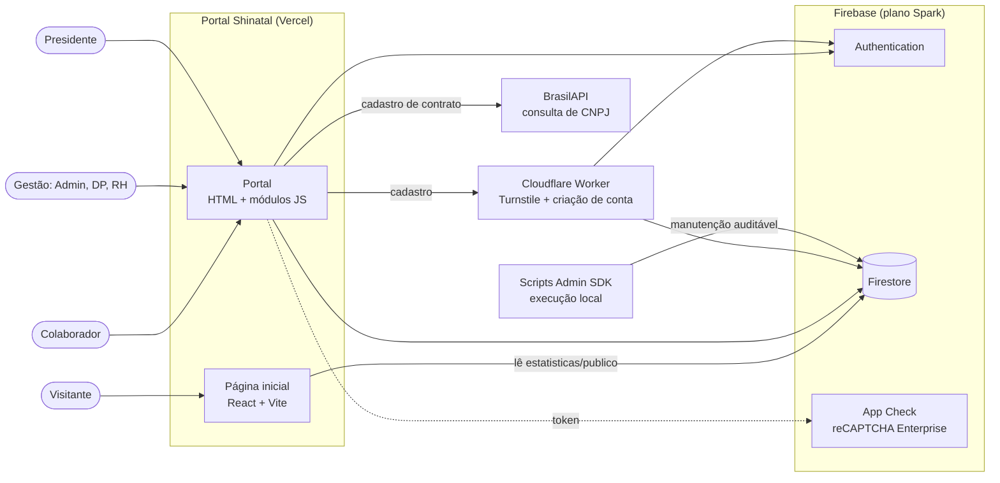
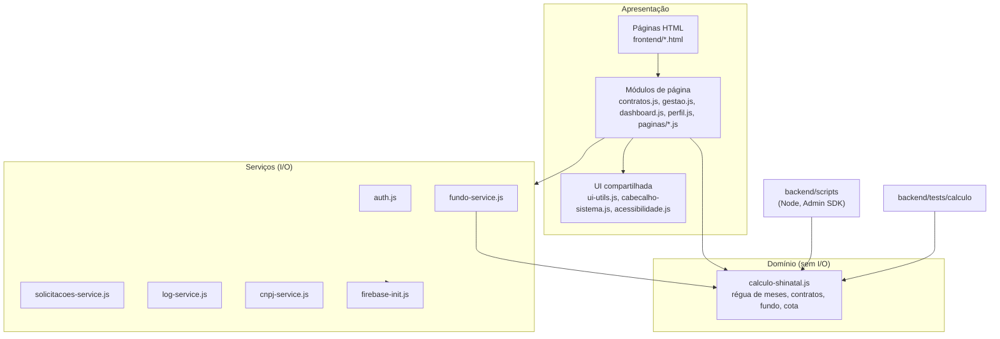
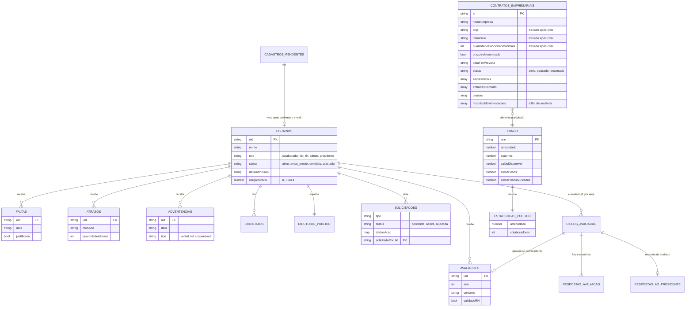
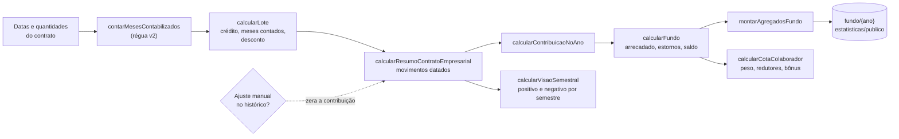
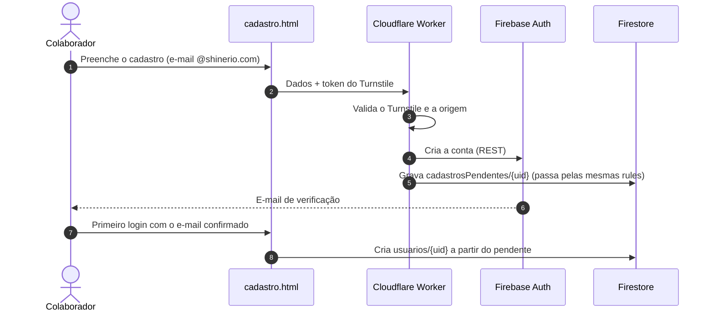
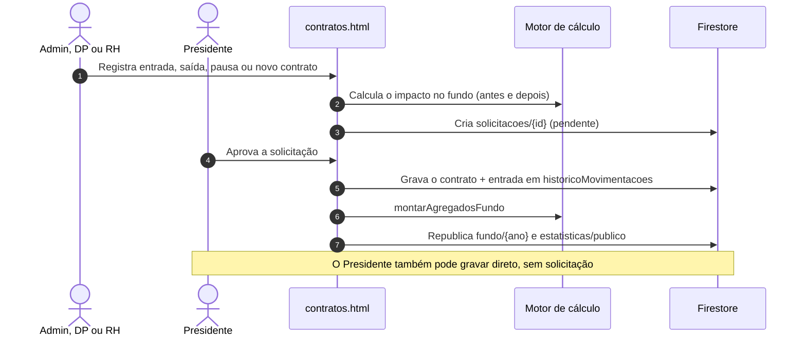
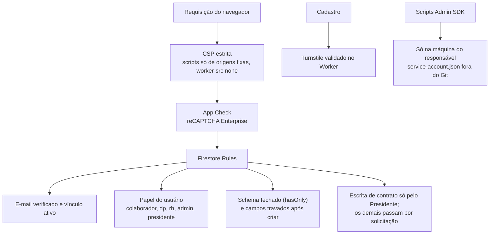
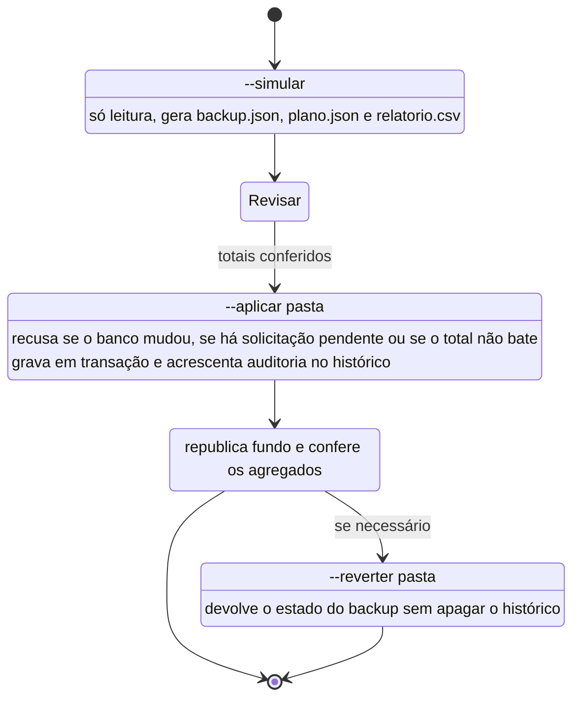
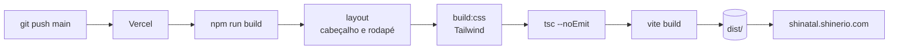

# Arquitetura do Shinatal

Referência técnica do portal: como as peças se encaixam, onde cada regra mora e por que foi feito assim.
Para instalar e configurar, veja o [guia de setup](guias/SETUP.md). Para a visão de produto, o [README](../README.md).

## Sumário

1. [Visão de contexto](#1-visão-de-contexto)
2. [Camadas e dependências](#2-camadas-e-dependências)
3. [Estrutura do repositório](#3-estrutura-do-repositório)
4. [Modelo de dados](#4-modelo-de-dados)
5. [Motor de cálculo](#5-motor-de-cálculo)
6. [Fluxos principais](#6-fluxos-principais)
7. [Segurança](#7-segurança)
8. [Manutenção de dados](#8-manutenção-de-dados)
9. [Build, deploy e cache](#9-build-deploy-e-cache)
10. [Testes](#10-testes)
11. [Decisões de arquitetura](#11-decisões-de-arquitetura)

---

## 1. Visão de contexto

O Shinatal não tem servidor próprio. O navegador fala direto com o Firebase, protegido por regras de segurança, App Check e um Worker da Cloudflare no cadastro.



## 2. Camadas e dependências

Cada página tem um módulo próprio. Os módulos usam serviços para falar com o Firestore, e todos os números saem de um único motor puro.



**Regra de dependência:** `calculo-shinatal.js` não importa nada e não faz I/O. As telas, o publicador do fundo, os scripts de manutenção e os testes importam o mesmo arquivo. Por isso o número da tela é sempre o mesmo número gravado no banco.

## 3. Estrutura do repositório

```text
.
├── app/                       Página inicial pública (React + TypeScript + Vite)
│   └── src/components/        Seções da home e componentes de UI
├── frontend/                  Portal (HTML + Tailwind + módulos ES)
│   ├── *.html                 Uma página por tela (login, painel, gestão, contratos, ...)
│   ├── js/                    Módulos de página, serviços e o motor de cálculo
│   │   ├── calculo-shinatal.js   Motor de cálculo (fonte única das regras)
│   │   └── paginas/           Módulos das telas de lançamento e solicitações
│   ├── css/                   Estilos do sistema e Tailwind compilado
│   └── assets/                Imagens, vídeos e fontes
├── backend/
│   ├── firestore.rules        Regras de segurança (schema, papéis, campos travados)
│   ├── cloudflare-worker/     Worker do Turnstile e da criação de conta
│   ├── scripts/               Manutenção com Admin SDK (simular, aplicar, reverter)
│   │   ├── dados/             Cópia versionada da planilha de controle
│   │   ├── lib/               Lógica pura dos scripts (testável)
│   │   └── legado/            Motor antigo congelado, só para comparação
│   └── tests/                 Cálculo, regras do Firestore e acessibilidade
├── scripts/                   Build: cabeçalho e rodapé, ícones, imagens, vídeo
├── docs/                      Documentação (índice em docs/README.md)
└── design/                    Referências visuais (não vai para o site)
```

## 4. Modelo de dados

Coleções do Firestore, conforme `backend/firestore.rules`. Nenhum valor em reais por contrato fica gravado. Os agregados `fundo/{ano}` e `estatisticas/publico` são só um cache publicado do que o motor calcula.



Também existem `logs` (trilha das ações de RH, só leitura para Admin e Presidente), `contratos` (contrato individual do colaborador, informativo) e `cadastrosPendentes` (dados do cadastro até a confirmação do e-mail).

## 5. Motor de cálculo

`frontend/js/calculo-shinatal.js` implementa o [Regulamento Interno](regras/Regulamento_Interno_Shinatal.pdf). As regras detalhadas, com exemplos, estão em [Regras de Cálculo](regras/Regras_de_Calculo_Shinatal.pdf).

### 5.1 Régua de meses (v2, nov/2026)

Toda contagem de meses de contrato passa por uma única função, `contarMesesContabilizados`. Ela trabalha só com datas de calendário (sem fuso horário) e trata ano bissexto.

| Evento | Regra | Exemplo |
|---|---|---|
| Entrada (início, entrada de funcionário, retomada de pausa) | Até o dia 14 o mês conta; do dia 15 em diante, começa no mês seguinte | 14/03 conta março; 15/03 começa em abril |
| Término previsto e encerramento do contrato | O mês final sempre conta | Encerrado em 01/09: setembro conta |
| Desligamento individual (e início de pausa) | O mês só conta se a pessoa ficou até o último dia | Saída em 16/09: setembro não conta; saída em 30/09: conta |

### 5.2 Do contrato ao fundo

O dinheiro é calculado **por lote de funcionários**: o quadro inicial, cada saída e cada entrada. Cada lote recebe R$ 12,50 por mês, até 12 meses (R$ 150,00). No prazo indeterminado, os 12 meses entram antecipados. Na saída, o lote passa a valer só os meses contados, e a diferença é descontada. Um desligamento nunca altera os outros lotes.



- **Exercício:** o crédito inicial pertence ao ano do mês de referência da implantação. Saídas e entradas pertencem ao ano da própria data. Um contrato de 2025 com saída em 2026 só desconta em 2026.
- **Ajuste manual:** uma entrada `{tipo: "ajuste_manual", efeito: "contribuicao_zero", motivo}` em `historicoMovimentacoes` faz o contrato contribuir com R$ 0,00. A régua não muda, e o card mostra quanto ela daria. Uma entrada `reversao_ajuste_manual` desfaz a exceção.
- **Cota do colaborador:** peso = avos trabalhados ÷ 12 × percentual da jornada (Seções 4 e 6). Depois vêm no máximo dois redutores percentuais (Seção 16), o desconto de faltas (Seção 7) e os adicionais (Seções 10 e 11). **Rateio:** o fundo é um valor fechado. Cada um tem um peso ajustado (peso × redutores × faltas × adicionais) e recebe saldo × peso ajustado ÷ soma dos pesos ajustados; os centavos do arredondamento vão para os maiores restos (`calcularDistribuicaoFundo`). A soma das cotas é exatamente o saldo. `fundo/{ano}` guarda `somaPesosAjustados` para a tela de cada colaborador calcular a própria cota, e o `fundo-service` republica sozinho quando muda contrato, colaborador, falta, atraso, advertência ou avaliação.
- **Avaliação de desempenho** (Seção 11, página `/avaliacao`): cada colaborador da tabela de avaliadores fixos (`configuracoes/avaliadoresFixos`, gravada só por `backend/scripts/avaliadores-fixos.mjs`) é avaliado pelo fixo e por um colega que ele escolhe. Cada um dá 5 notas de 0 a 5 e um parecer. O avaliado lê as duas avaliações e envia uma resposta que só o Presidente lê. No ok do Presidente, as regras recalculam a média (10 notas, 1 casa) e conferem a faixa do conceito; o ok cria `avaliacoes/desempenho_{ano}_{uid}`, que o motor de cálculo já usa. A antiga avaliação de conduta (votos anônimos) foi desativada em 11/2026; os dados ficam só para leitura do titular.

## 6. Fluxos principais

### 6.1 Cadastro de colaborador



### 6.2 Movimentação de contrato



### 6.3 Página pública

A home lê `estatisticas/publico` pela API REST do Firestore, sem login e sem cache (`no-store`), e atualiza a cada 60 segundos. Ela nunca calcula: mostra o que o motor publicou.

## 7. Segurança



- **Segredos:** nenhuma credencial fica no Git. A configuração web do Firebase é pública por natureza e fica protegida pelas rules e pelo App Check. As chaves do Turnstile e da conta de serviço ficam fora do repositório (`wrangler secret`, `.gitignore`).
- **Limites conhecidos do plano gratuito:** login e recuperação de senha chamam o Firebase Auth direto (não há Cloud Functions para interceptar). O valor do fundo publicado depende do cálculo no cliente; as rules só validam o formato.
- Política de segurança e como reportar: [SECURITY.md](../SECURITY.md). Auditorias: [docs/seguranca/](seguranca/).

## 8. Manutenção de dados

Mudanças em massa no banco (nova régua, reconciliação com a planilha) nunca são feitas à mão. Elas usam scripts com Admin SDK que seguem sempre o mesmo ciclo:



| Script | Para quê |
|---|---|
| `backend/scripts/recalcular-regra-v2.mjs` | Migração da régua de meses v1 para v2, contrato a contrato |
| `backend/scripts/importar-planilha-controle.mjs` | Reconciliação com a planilha de controle (`dados/planilha-controle-2026.json`, exercício 2026: R$ 8.800,00) |

Os dois são **idempotentes**: rodar de novo não duplica contratos nem lançamentos. Os backups ficam em `backend/scripts/out/`, que está fora do Git.

## 9. Build, deploy e cache



| Recurso | Cache |
|---|---|
| `/assets/*` (nomes com hash) | 1 ano, `immutable` |
| `/js/*` e `/css/*` | 300 s, `must-revalidate` |
| Páginas HTML | sem cache |
| Motor de cálculo | sufixo `?v=` nos imports, trocado a cada mudança de regra |

As regras do Firestore são publicadas à parte, com `firebase deploy --only firestore:rules`. O Worker é publicado com `wrangler deploy`.

## 10. Testes

| Suíte | Onde | Como rodar | Cobre |
|---|---|---|---|
| Cálculo | `backend/tests/calculo/` | `npm run test:calculo` | Régua v2, contratos, fundo, migração e cada linha da planilha de controle |
| Regras do Firestore | `backend/tests/rules/` | `cd backend/tests/rules && npm test` (emulador) | Papéis, schema, campos travados, tentativas de abuso |
| Acessibilidade e desempenho | `backend/tests/a11y/` | `cd backend/tests/a11y && npm test` (emulador) | axe-core, teclado, larguras de 320 a 1920 px e Lighthouse |

Nenhuma suíte toca produção: as duas últimas usam os emuladores do Firebase com dados fictícios.

## 11. Decisões de arquitetura

| # | Decisão | Por quê |
|---|---|---|
| 1 | Firebase sem servidor próprio (plano Spark) | Custo zero e menos peças para manter; a segurança fica nas rules, no App Check e no Worker |
| 2 | Motor de cálculo puro e único | Tela, banco, scripts e testes usam o mesmo código, então os números nunca divergem |
| 3 | Valores sempre recalculados, nunca gravados por contrato | Uma mudança de regra vale para contratos antigos e novos, sem migração de valores |
| 4 | Exceções e auditoria no `historicoMovimentacoes` | Toda decisão fica rastreável no próprio contrato, sem campo novo nas rules |
| 5 | Cadastro criado pelo Worker | O Firebase só é tocado depois que o Turnstile aprovou de verdade |
| 6 | Home em React, portal em HTML com módulos ES | A home precisa de animação e desempenho; o portal precisa ser simples de manter |
| 7 | Manutenção por scripts simular, aplicar, reverter | Mudanças em massa sempre com backup, conferência de totais e volta segura |
